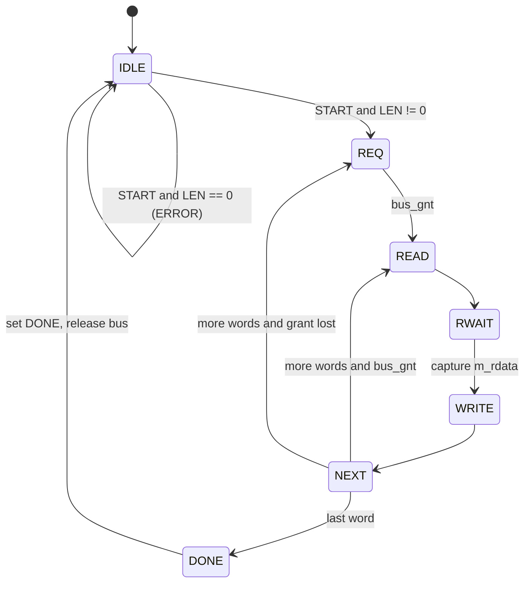

# DMA Controller in Verilog

A single-channel, memory-to-memory **DMA (Direct Memory Access) controller** written in synthesizable Verilog-2001, with a self-checking testbench verified in **ModelSim**.

The controller is programmed through a small register interface (source address, destination address, length), arbitrates for the bus with a request/grant handshake, and moves data using a read → write state machine without CPU involvement.

---

## Features

- Programmable **source address**, **destination address** and **transfer length**
- FSM-based transfer cycle: `REQ → READ → RWAIT → WRITE → NEXT → DONE`
- **Bus request / grant handshake**; the DMA drives the bus only while granted
- Handles a **delayed grant** and a **grant taken away between words** (waits and resumes without losing progress)
- **Status flags**: `BUSY`, `DONE`, `ERROR` (zero-length transfer)
- **Interrupt output** with enable bit and clear-on-write
- Register writes and a second `START` are **ignored while busy**
- Parameterised address, data and length widths

---

## Block Diagram

```
          CPU side                                    Bus side
   ┌──────────────────┐                     ┌──────────────────────────┐
   │ reg_we           │                     │ bus_req  ───────────►    │
   │ reg_addr[1:0]    │     ┌───────────┐   │ bus_gnt  ◄───────────    │
   │ reg_wdata[31:0]  ├────►│    DMA    ├──►│ m_addr, m_wdata          │──► Memory
   │ reg_rdata[31:0]  │◄────┤ CONTROLLER│   │ m_re, m_we               │
   │ irq              │◄────┤           │◄──│ m_rdata                  │◄── Memory
   └──────────────────┘     └───────────┘   └──────────────────────────┘
```

---

## Register Map

| `reg_addr` | Name        | Access | Description                                                  |
|:----------:|-------------|:------:|--------------------------------------------------------------|
| `0`        | `SRC_ADDR`  | R/W    | Source start address (ignored while busy)                    |
| `1`        | `DST_ADDR`  | R/W    | Destination start address (ignored while busy)               |
| `2`        | `LEN`       | R/W    | Number of words to transfer (ignored while busy)             |
| `3`        | `CTRL/STATUS` | R/W  | See below                                                    |

**CTRL (write)**

| Bit | Name     | Description                                    |
|:---:|----------|------------------------------------------------|
| 0   | `START`  | Start the transfer (ignored if busy)           |
| 1   | `CLR`    | Clear `DONE` and `ERROR` flags                 |
| 2   | `IRQ_EN` | Enable the interrupt output                    |

**STATUS (read)**

| Bit | Name     | Description                                    |
|:---:|----------|------------------------------------------------|
| 0   | `BUSY`   | Transfer in progress                           |
| 1   | `DONE`   | Last transfer completed                        |
| 2   | `ERROR`  | `START` issued with `LEN = 0`                  |
| 3   | `IRQ_EN` | Interrupt enable                               |

`irq = IRQ_EN & DONE`

---

## Programming Sequence

```
write SRC_ADDR   <- source address
write DST_ADDR   <- destination address
write LEN        <- number of words
write CTRL       <- 0x1            // START   (0x5 to also enable the interrupt)
poll STATUS.DONE (or wait for irq)
write CTRL       <- 0x2            // CLR done flag
```

---

## FSM



| State   | Action                                                              |
|---------|---------------------------------------------------------------------|
| `IDLE`  | Wait for `START`; latch SRC/DST/LEN into working registers          |
| `REQ`   | Assert `bus_req`, wait for `bus_gnt`                                |
| `READ`  | `m_re = 1`, `m_addr = src`                                          |
| `RWAIT` | Memory data valid (1-cycle read latency); capture into `data_buf`   |
| `WRITE` | `m_we = 1`, `m_addr = dst`, `m_wdata = data_buf`                    |
| `NEXT`  | Increment addresses, decrement count, decide next state             |
| `DONE`  | Release bus, set `DONE` flag                                        |

**Throughput:** 4 clock cycles per word (`READ`, `RWAIT`, `WRITE`, `NEXT`), plus the grant latency at the start. The bus is held for the whole burst unless the arbiter takes it away between words.

### Per-word timing

```
clk      : _|‾|_|‾|_|‾|_|‾|_|‾|_
state    :  READ  RWAIT WRITE NEXT
m_re     :   1     0     0     0
m_we     :   0     0     1     0
m_addr   :  src    src   dst   -
m_rdata  :   -    data   -     -
```

---

## Repository Structure

```
.
├── dma_controller.v   # DMA controller RTL
├── memory.v           # Synchronous memory model (1-cycle read latency)
├── tb_dma.v           # Self-checking testbench (arbiter model + protocol checker)
├── run.do             # ModelSim script: compile, load waves, run
└── README.md
```

---

## How to Simulate

### ModelSim (GUI or transcript)

```tcl
cd C:/path/to/this/folder
do run.do
```

This compiles the design, loads the waveform signals and runs the testbench. The testbench ends with `$stop`, so the waveform stays open for inspection.

### ModelSim (command line)

```bash
vlib work
vlog memory.v dma_controller.v tb_dma.v
vsim -c work.tb_dma -do "run -all; quit"
```

## Verification

The testbench is **self-checking** and contains:

- A **behavioural bus arbiter** with programmable grant latency and a "steal" mode that takes the bus away after every third write
- A **protocol checker** that flags any `m_re` / `m_we` issued without a grant
- **Data checks** on every transfer: destination matches source, source is unmodified, and the words immediately before and after the destination are not overwritten (guard words)

| Test | Scenario                                                        |
|:----:|-----------------------------------------------------------------|
| T1   | Basic 16-word copy                                              |
| T2   | Single-word copy                                                |
| T3   | Zero-length transfer: `ERROR` flag set, no bus request          |
| T4   | 64-word copy with zero-latency grant                            |
| T5   | Slow grant (6 cycles) with the bus stolen and regranted mid-transfer |
| T6   | Register writes and a second `START` ignored while busy         |
| T7   | Back-to-back transfers                                          |
| T8   | Interrupt asserts on completion and clears with `CLR`           |

### Result

```
PASS : T1 basic 16-word copy
PASS : T2 single-word copy
PASS : T3 zero-length -> ERROR flag
PASS : T4 64-word copy, fast grant
PASS : T5 slow grant + bus steal/regrant
PASS : T6 writes/start ignored while busy
PASS : T7 back-to-back transfers
PASS : T8 irq asserted on completion
PASS : T8 irq cleared by CLR
==== ALL TESTS PASSED ====
```


## Parameters

| Parameter | Default | Description               |
|-----------|:-------:|---------------------------|
| `ADDR_W`  | 8       | Address width (bits)      |
| `DATA_W`  | 32      | Data width (bits)         |
| `LEN_W`   | 8       | Transfer length width     |

---


## Tools

- Verilog-2001
- ModelSim 


MITHUN NITHEESH ROGAN R
